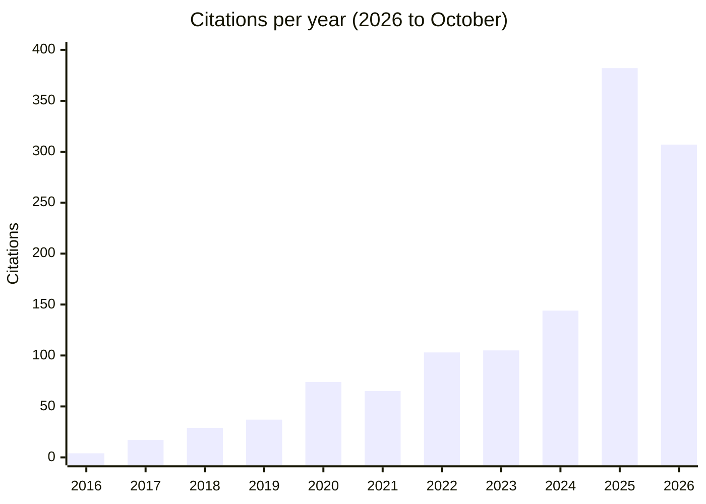
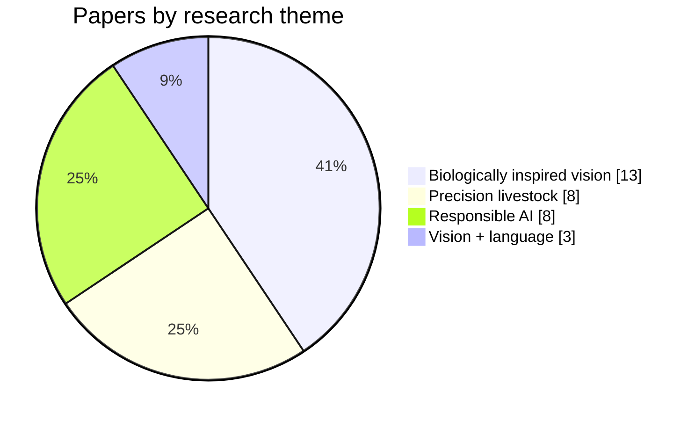

<h1 align="center">Dr Ali Alameer</h1>

  <b>Lecturer in Artificial Intelligence</b> · School of Science, Engineering &amp; Environment · University of Salford 
  PhD in AI, Newcastle University · Elected member of the University Senate

  
  
  
  
  
  

I build multimodal machine learning methods that integrate high-dimensional visual, temporal and textual data, and put them to work in places that are hard on models: livestock barns, courtrooms, insurance claims and building surveys.

## At a glance

| Citations | h-index | i10-index | Publications | Research funding | Ongoing projects | Research students |
| :-: | :-: | :-: | :-: | :-: | :-: | :-: |
| **1,296** | **15** | **24** | **32** | **£1.25m** | **4** (£959k) | **7** |
| 1,123 since 2021 | 12 since 2021 | 18 since 2021 | since 2015 | 10 awards | 3 KTPs + 1 grant | 5 current, 2 completed |

Google Scholar snapshot, October 2026. GitHub badges above update live.

### Citations per year

## Research themes

| Theme | Papers | Citations | What it covers |
| :-- | :-: | :-: | :-- |
| 🐖 **Machine vision for animal welfare** | 8 | 418 | Deep learning and vision transformers that recognise posture, feeding, drinking and social contact in pigs and dairy cows from ordinary pen cameras, so compromised health shows up in the data before it shows up in the animal. |
| 🏗️ **Multimodal AI for industry** | 3 | 6 | Vision-language and speech models built with industrial partners through Knowledge Transfer Partnerships: digital building surveys, motor insurance claims, document query management and court transcription. |
| ⚖️ **Fairness, bias and governance** | 8 | 366 | Detecting and mitigating algorithmic bias in recruitment, speech recognition in legal settings, and inclusive prompt engineering for large language models. |
| 👁️ **Biologically inspired vision** | 13 | 402 | PhD work at Newcastle: hierarchical models of the visual cortex (EN-HMAX), context-based object recognition, and early deep learning for grasp classification in prosthetic hands. |

## Selected publications

| Year | Paper | Venue | Cited |
| :-: | :-- | :-- | --: |
| 2024 | A comprehensive review of AI techniques for addressing algorithmic bias in job hiring | *AI* 5(1) | 281 |
| 2017 | Deep learning-based artificial vision for grasp classification in myoelectric hands | *Journal of Neural Engineering* 14(3) | 237 |
| 2020 | Automated recognition of postures and drinking behaviour for the detection of compromised health in pigs | *Scientific Reports* 10(1) | 147 |
| 2020 | Automatic recognition of feeding and foraging behaviour in pigs using deep learning | *Biosystems Engineering* 197 | 144 |
| 2025 | Vision transformers for automated detection of pig interactions in groups | *Smart Agricultural Technology* 10 | 54 |
| 2025 | Inclusive prompt engineering for large language models: a modular framework for ethical, structured, and adaptive AI | *Artificial Intelligence Review* 58(11) | 12 |
| 2025 | Vision transformer-based multi-camera multi-object tracking framework for dairy cow monitoring | *Smart Agricultural Technology* | 7 |

<b>All 32 publications</b> (click to expand)

#### 2026
- HADQEF: a hybrid AI framework for enhancing Arabic data quality and governance in alignment with Saudi Vision 2030. *Discover Artificial Intelligence*.
- Understanding contest skill to reduce the welfare costs of aggression. *Biology Letters* 22(4).
- Addressing intersectional bias in AI recruitment using HITHIRE model: a fair, ethical, green AI and transparent hiring solution for Saudi Arabia's diverse workforce. *AI and Ethics* 6(1). (5 citations)
- COLLAB-LLM: a communication-centric role-based framework for scalable multi-agent LLM collaboration. *Asian Journal of Research in Computer Science* 19(1). (2)

#### 2025
- Vision transformer-based multi-camera multi-object tracking framework for dairy cow monitoring. *Smart Agricultural Technology*. (7)
- HitHire: the future of ethical, fair, and sustainable AI recruitment. A governance framework. *Array*. (9)
- Inclusive prompt engineering for large language models: a modular framework for ethical, structured, and adaptive AI. *Artificial Intelligence Review* 58(11). (12)
- A comparative analysis of state-of-the-art speech-to-text models for court applications. *Intl. Conference on Data Science, AI and Applications*. (1)
- Vision transformers for automated detection of pig interactions in groups. *Smart Agricultural Technology* 10. (54)
- A newly adopted YOLOv9 model for detecting mould regions inside of buildings. *Intl. Journal of Pattern Recognition and Artificial Intelligence* 39. (3)
- Generative AI and the future of software engineering in Saudi Arabia: governance, innovation, and workforce transformation. *Intl. Journal of Theoretical & Applied Computational Intelligence*. (16)
- Saudi Arabia's Vision 2030: leveraging generative artificial intelligence to enhance software engineering. *8th Intl. Women in Data Science Conference*. (15)

#### 2024
- RLS adaptive filter co-design for de-noising ECG signal. *Results in Engineering* 24. (15)
- Review of farmer-centered AI systems technologies in livestock operations. *CABI Reviews* 19(1). (11)
- The intersection of generative AI and healthcare: addressing challenges to enhance patient care. *7th Intl. Women in Data Science Conference*. (28)
- A comprehensive review of AI techniques for addressing algorithmic bias in job hiring. *AI* 5(1), 383–404. (281)

#### 2023
- Toward the automated detection of behavioral changes associated with the post-weaning transition in pigs. *Frontiers in Veterinary Science* 9. (10)

#### 2022
- Automated detection and quantification of contact behaviour in pigs using deep learning. *Biosystems Engineering* 224, 118–130. (45)
- Labeled projective dictionary pair learning: application to handwritten numbers recognition. *Information Sciences* 609, 489–506. (16)

#### 2021
- Classification of handwritten Chinese numbers with convolutional neural networks. *5th Intl. Conference on Pattern Recognition and Image Analysis*. (8)

#### 2020
- Automatic recognition of feeding and foraging behaviour in pigs using deep learning. *Biosystems Engineering* 197, 91–104. (144)
- Automated recognition of postures and drinking behaviour for the detection of compromised health in pigs. *Scientific Reports* 10(1). (147)
- Objects and scenes classification with selective use of central and peripheral image content. *Journal of Visual Communication and Image Representation* 66. (10)

#### 2019
- Context-based object recognition: indoor versus outdoor environments. *Science and Information Conference*. (12)

#### 2018
- Incoherent dictionary pair learning: application to a novel open-source database of Chinese numbers. *IEEE Signal Processing Letters* 25(4). (18)
- Biologically-inspired hierarchical architectures for object recognition. *PhD thesis, Newcastle University*. (5)

#### 2017
- Deep learning-based artificial vision for grasp classification in myoelectric hands. *Journal of Neural Engineering* 14(3). (237)
- Processing occlusions using elastic-net hierarchical max model of the visual cortex. *IEEE INISTA*. (8)

#### 2016
- Object recognition with an elastic net-regularized hierarchical MAX model of the visual cortex. *IEEE Signal Processing Letters* 23(8). (20)
- Biologically-inspired object recognition system for recognizing natural scene categories. *ICSAE*. (10)

#### 2015
- An exploratory study on the use of convolutional neural networks for object grasp classification. *Intelligent Signal Processing Conference*. (32)
- An elastic net-regularized HMAX model of visual processing. *Intelligent Signal Processing Conference*. (11)

Full list on [Google Scholar](https://scholar.google.com/citations?user=tiQjPacAAAAJ&hl=en) and the [Salford research repository](https://salford-repository.worktribe.com/person/1178234/ali-alameer).

## Research funding

**£1.25m** across 10 awards: £879k in Knowledge Transfer Partnerships, £297k in grants and £73k in consultancy.

<b>All awards</b> (click to expand)

| Project | Type | Funder / partner | Amount | Status |
| :-- | :-: | :-- | --: | :-: |
| Computer vision and NLP for motor insurance | KTP | Innovate UK / Whichrate Ltd | £298,230 | 🟢 Ongoing |
| Vision and NLP for text and image query management | KTP | Innovate UK / TSK Group | £293,603 | 🟢 Ongoing |
| Vision-language model for digital surveying | KTP | Innovate UK / Corelain Ltd | £287,332 | 🟢 Ongoing |
| AI fairness, bias and digital sustainability | Grant | Research grant | £135,619 | ✔️ Completed |
| Sustainable dairy farming via machine vision | Grant | British Council / ISPF | £79,942 | 🟢 Ongoing |
| ELI: Expert Legal Intelligence | Grant | Research grant (Salford share) | £78,514 | ✔️ Completed |
| ASR bias and fairness evaluation for legal deployment | Consultancy | Industry | £37,728 | ✔️ Completed |
| Personalised AI recommendation engine | Consultancy | World Privilege Ltd | £19,743 | ✔️ Completed |
| Applied AI safety training programme | Consultancy | Industry | £16,000 | ✔️ Completed |
| Ethical AI auditing tool validation | Grant | Research grant | £2,500 | ✔️ Completed |

## Teaching and open source

Course material for the MSc in Artificial Intelligence is public, and used well beyond Salford.

| Repository | What it is | Stars | Forks |
| :-- | :-- | :-: | :-: |
| [Deep-Learning](https://github.com/Ali-Alameer/Deep-Learning) | MSc AI module: notebooks on the foundations of deep learning |  |  |
| [NLP](https://github.com/Ali-Alameer/NLP) | MSc AI module: NLP in Keras and TensorFlow, from tokenisation to transformers |  |  |
| [AI_fairness](https://github.com/Ali-Alameer/AI_fairness) | Libraries, tools and tutorials for identifying and mitigating bias in ML models |  |  |
| [Machine-Vision](https://github.com/Ali-Alameer/Machine-Vision) | Object detection, image classification and transfer learning in TensorFlow and PyTorch |  |  |
| [RAICo-AI-Summit---Basics-of-AI](https://github.com/Ali-Alameer/RAICo-AI-Summit---Basics-of-AI) | Materials from the RAICo AI Summit session on the basics of AI |  |  |
| [portfolio](https://github.com/Ali-Alameer/portfolio) | Source of my academic portfolio site (Next.js) |  |  |

<b>Open datasets</b>

- Hand Recognition Dataset for Machine Vision Researchers (YOLOv8 format), 2023
- Facial Emotion Detection Dataset, 2023
- Facial Expression Image Dataset for Computer Vision Algorithms, 2022 (with O Osonuga)
- UoS Buildings Image Dataset for Computer Vision Algorithms, 2022 (with M Al-Mosawy)

## Supervision

<b>Current research students (5)</b>

| Name | Degree | Topic |
| :-- | :-: | :-- |
| Yakup Keskindag | PhD | Privacy-preserving small language models |
| Rashid Yaghi | PhD | AI governance |
| Gbadegesin Taiwo | PhD | Machine vision for pig behaviour detection |
| Ali Jamali | MPhil | AI-based recommendation systems |
| Maryam Vadikheil | MPhil | Transformer-based deepfake detection |

<b>Completed PhDs (2)</b>

| Name | Topic |
| :-- | :-- |
| Elham Albaroudi | AI fairness in job hiring |
| Kumail Abbas | Machine vision for cow behaviour detection, with Chulalongkorn University and the University of Bristol |

<b>KTP associates (3)</b>

| Name | Project |
| :-- | :-- |
| Zeeshan Afzal | Vision-language model digital surveying tool |
| Mohamed Maharoof | LLM and vision models for indexing and cross-referencing |
| AJ Shoaib | Computer vision and NLP for motor insurance |

## Tools I work with

---

Open to collaboration on applied multimodal AI, responsible AI and Knowledge Transfer Partnerships. Get in touch at <a href="mailto:A.Alameer1@salford.ac.uk">A.Alameer1@salford.ac.uk</a>.

